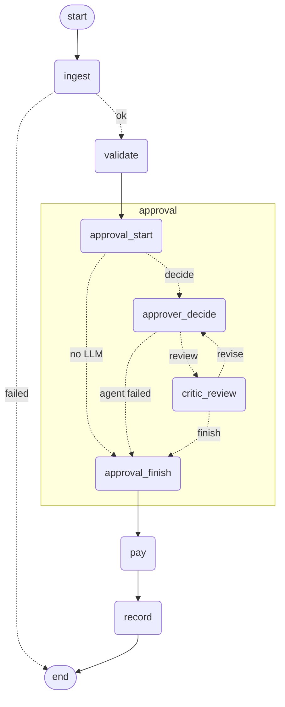

# Acme Invoice Processing: Multi-Agent Pipeline

A working prototype that automates Acme Corp's invoice workflow end to end: **read** the invoice, **validate** it against inventory, get an **approval decision double-checked by a second AI model**, then **pay** it or log why not. It runs locally from the command line, one invoice at a time.

Acme loses **$2M/year** to manual invoice processing, with a **30% error rate** and **5-day delays**. The pipeline targets both problems:

- **Errors:** the checks that catch the expensive mistakes (arithmetic, stock, duplicates, missing data) are done by code, not by people or by an LLM's judgement.
- **Delays:** an invoice is processed in seconds to under a minute, depending on API rate limits.
- **Judgement:** a human sees only the invoices that need it: disagreements between the agents, unclear currencies, and anything the system can't verify.

> The original case brief is preserved in [docs/CASE_BRIEF.md](docs/CASE_BRIEF.md).

---

## Contents

1. [Quick start](#quick-start)
2. [What happens to the sample invoices](#what-happens-to-the-sample-invoices)
3. [Architecture](#architecture)
4. [Architectural decisions and why](#architectural-decisions-and-why)
5. [Scope: what is deliberately not done](#scope-what-is-deliberately-not-done)
6. [Roadmap](#roadmap)
7. [Project layout](#project-layout)
8. [Testing](#testing)

---

## Quick start

### Prerequisites
- **Python 3.10+** (developed on 3.12)
- A **Groq API key** (free tier works): [console.groq.com/keys](https://console.groq.com/keys)
- *Optional:* an **Anthropic API key** for the critic agent (Claude Opus 5.5): [console.anthropic.com](https://console.anthropic.com/). Without it, the critic falls back to Qwen on Groq.

### Setup
```bash
git clone <this repo> && cd galatiq-case-invoices
python3 -m venv .venv
source .venv/bin/activate          # Windows: .venv\Scripts\activate
pip install -r requirements.txt

cp .env.example .env               # then put your key(s) in .env
```

`.env`:
```
GROQ_API_KEY=gsk_...
ANTHROPIC_API_KEY=sk-ant-...       # optional
```

The SQLite database (`inventory.db`) is **created and seeded automatically** on the first run. To create it by hand, run `python db/seed_inventory.py`.

### Run
```bash
python main.py --invoice_path=data/invoices/invoice_1001.txt
```

| Option | What it does |
|---|---|
| `--invoice_path=PATH` | Process one invoice (`.txt`, `.pdf`, `.json`, `.csv`, `.xml`) |
| `--json` | Print the full result as JSON instead of tables |
| `--log-level WARNING` | Hide the step-by-step logs and show only results |
| `--graph` | Print the pipeline graph as a Mermaid diagram |
| `--reset-ledger` | Clear paid, rejected and escalated records so invoices can be demoed again (asks you to type `reset`) |

### Output
- **Terminal:** one section per stage, followed by a run summary with token usage.
  1. the extracted invoice and its line items
  2. the validation checks and the agent's summary
  3. each approval round, with the critic's evidence
  4. the payment outcome
- **`logs/pipeline.jsonl`:** structured logs, one JSON object per line, with a `run_id` on every line and token usage for every LLM call.
- **`logs/rejections.jsonl`** and **`logs/human_review.jsonl`:** full reasoning for every rejected or escalated invoice.
- **`inventory.db`:** the payment ledger, plus a record of every run with its line items.

---

## What happens to the sample invoices

The code-based stages (extraction from JSON/CSV/XML, validation, currency rules, payment) behave the same every run. The final decision on invoices that **pass** validation is the agents' judgement. **Bold** rows were run through the full pipeline live against the real models during development. For the other rows, the validation findings were checked, and the outcome follows from the code's rules or, where noted, the agents' judgement.

| Invoice | What the system finds | Outcome |
|---|---|---|
| **1001** (txt) | Clean | **APPROVED → paid $5,000** |
| 1002 (txt) | Messy text, read correctly; GadgetX 20 ordered, 5 in stock | REJECTED |
| **1003** (txt) | Due date "yesterday"; FakeItem has zero stock; extra review finds "URGENT… wire transfer" and "Fraudster LLC" | **REJECTED** |
| **1004** (json) | Valid, but superseded by revision R1 | **REJECTED** (agents: older revision shouldn't be paid) |
| **1004_revised** (json) | Revision R1, valid | **APPROVED → paid $5,940** |
| **1005** (json) | GadgetX 8 ordered, 5 in stock | **REJECTED** |
| 1006 (csv) | Valid, but no currency stated | ESCALATED (human review, not paid) |
| 1007 (csv) | Total is $110 lower than subtotal + tax; WidgetA and WidgetB over stock; no currency | ESCALATED (missing currency always goes to a human) |
| 1008 (txt) | SuperGizmo and MegaSprocket aren't in inventory | REJECTED |
| 1009 (json) | No vendor, no due date, negative quantity and total, subtotal doesn't match lines | REJECTED |
| 1010 (txt) | Repeated item with a rush price; shipping included; valid | APPROVED (agents' judgement) |
| 1011 (txt + pdf) | Same invoice in two formats; the PDF's missing fields are filled from the txt | First copy APPROVED; second REJECTED as a duplicate |
| 1012 (txt + pdf) | OCR typos (`2O26`, `$3,500.O0`), `Widget A`, `INV 1012`, all read correctly | APPROVED (agents' judgement) |
| 1013 (json + pdf) | Total is **$50 higher** than subtotal + tax; all three items over stock once repeated lines are added up | REJECTED |
| **1014** (xml) | Amounts are in EUR | **ESCALATED** (non-USD always goes to a human) |
| 1015 (csv) | Valid, but no currency stated | ESCALATED |
| 1016 (json) | WidgetC isn't in inventory | REJECTED |

---

## Architecture

### The pipeline graph

The stages are orchestrated with **LangGraph** ([orchestrator.py](orchestrator.py)). The approver↔critic loop is a nested subgraph ([approval/graph.py](approval/graph.py)), so the revision cycle is an actual edge in the graph. This is a simplified version, with clearer edge labels, of the diagram `python main.py --graph` generates from the compiled graph:



### Stages and agents

| Stage | What it does | Code / LLM | Model |
|---|---|---|---|
| **1. Ingest** | Reads the file and extracts structured fields; standardises names, dates and numbers; finds revisions and copies of the same invoice; flags data problems | Code parsers for JSON/CSV/XML. **Extraction LLM** for TXT/PDF, with a self-correction loop. | `openai/gpt-oss-120b` (Groq) |
| **2. Validate** | Arithmetic, inventory, dates, duplicates, data integrity → PASS / FAIL | 5 code checks, called as tools by the **validation agent**, which writes a summary | `openai/gpt-oss-120b` (Groq) |
| **3. Approve** | Approve or reject with reasons; extra review over $10K; a critic double-checks against the original document | **Approval agent** + **critic agent** (different provider), with a revision loop | Approver: `gpt-oss-120b` · Critic: `claude-opus-5-5` (fallback `qwen/qwen3.8-27b`) |
| **4. Pay** | Pays approved invoices through the mock bank; logs rejections and escalations | Code only | none |
| **5. Record** | Stores the run's invoice, line items and outcomes | Code only | none |

### Data

| Store | Contents |
|---|---|
| `inventory` table | Item name and stock (WidgetA 15, WidgetB 10, GadgetX 5, FakeItem 0) |
| `processed_invoices` table | Ledger with one row per outcome: `paid`, `payment_failed`, `rejected`, `escalated`, `held_for_review` |
| `invoice_records` and `invoice_line_items` tables | Every run's extracted invoice (including the vendor address), flags, and stage outcomes |
| `logs/*.jsonl` | Structured run logs, the rejection log and the human-review queue |

### Outcomes

| Final status | Meaning | Payment step |
|---|---|---|
| **APPROVED** | Validation passed, the agent approved, and the critic agreed with verified evidence | `mock_payment(...)` is called; ledger row `paid` |
| **REJECTED** | Validation failed, or the agent rejected and the critic agreed | Not paid; logged to `logs/rejections.jsonl` |
| **ESCALATED** | Needs a human VP: agent and critic still disagree, the critic's evidence can't be verified, an agent failed, or the currency is missing or non-USD | Not paid; logged to `logs/human_review.jsonl` |

---

## Architectural decisions and why

### Orchestration

**1. LangGraph state graph, with approval as a nested subgraph.**
The four stages hand typed data (Pydantic models) from one to the next, and the only real back-and-forth between agents is the approver↔critic loop. A graph makes that structure explicit, testable and drawable: the revision cycle is a real edge, and if ingestion fails, the graph routes straight to END so nothing can be paid. The same compiled subgraph is used by the full pipeline and by the approval stage on its own, so the loop is defined in one place.

**2. LLMs where judgement or messy text is involved; code wherever there's a right answer.**
- **LLMs:** reading unstructured invoices, writing summaries, judging red flags, reviewing decisions.
- **Code:** arithmetic, stock, duplicates, PASS/FAIL, the policy rules, and every decision that moves money.

This is the core reliability decision. An LLM can be persuaded or can miscount; a SQL lookup can't.

**3. Groq instead of xAI Grok.**
The brief allows other models when no xAI key is available. Groq offers several model families behind one key, which made a genuinely *different* model available for the critic fallback. The Groq client retries rate-limited calls automatically (`max_retries=5`).

### Ingestion

**4. Hybrid extraction: code parsers for JSON, CSV and XML; the LLM for TXT and PDF.**
Structured files have exact values, and parsing them in code is free, fast and can't invent data. An LLM is only needed where the layout is unpredictable. A structured file with an unfamiliar layout falls back to the LLM, flagged as `parser_fallback`.

**5. Self-correction through grounding.**
- The LLM's JSON must fit the schema, and the vendor, item names and every number it returns must appear in the source document.
- If not, the specific problems go back to the model, for up to 3 attempts.
- Values still not found after that are kept with a `ungrounded_value` warning, not silently trusted.

This turns "the model might hallucinate" into a checked, logged property.

**6. The LLM copies; code standardises.**
The prompt tells the model to copy values exactly as written, typos included. Standardisation is done by code, the same way every time:
- dates, in 12 formats (numeric dates read month-first)
- the letter O used instead of zero (`2O26` → `2026`)
- invoice numbers (`INV 1012` → `INV-1012`)
- item names matched exactly against the inventory after ignoring case and spacing (`Widget a` → `WidgetA`). There's no loose matching, so `WidgetC` never becomes `WidgetA`.

The original text is kept alongside, for example `due_date_raw = "yesterday"`.

**7. Ingestion flags problems; it never rejects.**
Each problem gets a severity, and that severity decides what happens downstream:

| Severity | Examples | Effect |
|---|---|---|
| **error** | missing vendor, total, due date, invoice number, item name or quantity; negative or zero values; unreadable dates or numbers | Validation FAILs |
| **warning** | superseded revision, conflict between copies, missing or non-USD currency, missing unit price | The agents see it; it may lead to escalation |
| **info** | name standardised, field filled from a copy | Transparency only |

**8. Revisions: process the file given, and flag if a newer one exists.**
Revisions are detected from the filename (`_revised`, `_rev2`), a revision field, or "Revised" wording, for every format. Silently switching to another file would hide what happened, so the file given is processed and the reviewer sees a `superseded_revision` warning.

**9. Copies in other formats fill gaps and surface conflicts.**
1011, 1012 and 1013 exist in two formats. When a field is missing in one copy, it's filled from the other (info). A field that differs between them raises a warning, because two "identical" documents that disagree is a fraud and quality signal. A date that's present but unreadable is *not* filled from the copy, so the problem isn't hidden.

### Validation

**10. Checks are code; the agent runs them as tools and explains them.**
- The validation agent decides which tool to call and writes a plain-English summary.
- It never calculates anything itself, and never decides PASS or FAIL.
- If it skips a check, it's reminded. If it still doesn't call it, code runs it anyway.
- PASS/FAIL is always calculated from all five results, so a forgetful or manipulated agent can't hide a failure.

**11. Stock is checked per item, summed across lines.**
INV-1013 never exceeds stock on any single line, but its repeated lines add up to WidgetA 22 > 15, WidgetB 18 > 10 and GadgetX 9 > 5. Checking line by line would have missed it. Stock is **compared, never changed**, so runs are repeatable and don't depend on order.

**12. Duplicates: matched on invoice number, against paid invoices only.**
- Same revision already paid, or a newer revision paid: **error**.
- Only an older revision paid: **warning**.
- Rejected or escalated invoices don't count, so a corrected invoice can be resubmitted.
- The payment stage checks the ledger again right before paying, to catch anything paid in the meantime.

**13. Any error means FAIL; warnings pass on to approval.**
A simple, auditable rule. Judgement calls belong in approval, not validation.

### Approval

**14. Every invoice goes to the approval agent; over $10K gets a mandatory extra review.**
Above $10,000, the agent must report findings for three areas:
1. pressure or payment red flags
2. suspicious vendor or items
3. unusual amounts or quantities

If it leaves them out, it's sent back. All five sample invoices over $10K fail validation, so routing failed invoices straight to rejection would have meant the extra review never ran.

**15. A validation FAIL can never be approved. This is enforced in code.**
If the agent tries, it's told about the policy violation. If it insists, code changes the decision to REJECT. The LLM can't override the rule, however it's prompted, and that includes by text inside the invoice.

**16. The critic is a different provider, sees the original document, and must cite evidence.**
- **Different provider:** Claude Opus 5.5 (Anthropic) reviews gpt-oss (Groq). Different training means they're less likely to share a blind spot. Without an Anthropic key, Qwen on Groq is used, which is still a different model family.
- **Original document:** the critic checks the *extraction* as well as the reasoning, so extraction mistakes can be caught.
- **Verified evidence:** every point it makes must cite a document quote, an extracted field or a validation check. Code verifies that quotes appear in the document, that field and check names exist, and that every number appears in the source data ([approval/grounding.py](approval/grounding.py)). If the critic can't back up its review after one retry, it isn't trusted, and the invoice is escalated.

**17. Disagreement leads to up to 2 revision rounds, then a human.**
The agent revises using the critique and explains which points it accepted or rejected. If the two still disagree, neither model gets the final word: a human VP does. The same applies when the critic or approver is unavailable. The system **fails safe**: anything not positively approved is never paid.

**18. Payment terms are never interpreted.**
Acme hasn't defined what "Net 15" or "Net 30" means for this process, so no check or agent compares terms with dates. They're reported only as written, and every agent prompt carries this rule.

**19. Currency: anything other than a stated USD goes to a human.**
- **Missing currency:** a warning, then escalated, never paid.
- **Non-USD:** a warning, then escalated, even if validation failed.

The scope doesn't define how to handle these, so the agents still run (giving the reviewer their opinion), and code forces escalation. `$` on text invoices is read as USD.

### Payment

**20. The mock bank function is extended, and code guards it.**
- `mock_payment(vendor, amount, currency, invoice_number, reference)` stands in for the bank API, so it also receives the currency, the invoice number and our payment reference.
- Before calling it, code checks the ledger again and requires an invoice number, a vendor, a currency and a positive amount.
- Payment is immediate, with up to 3 attempts. If every attempt fails, it's recorded as `payment_failed` and not marked paid, so it can be re-run safely.

**21. A newer revision pays only the difference.**
If R0 was paid and R1 is approved, only `R1 total − amount already paid` is paid. If nothing is owed or the earlier payment was larger, the invoice is held for human review as a possible refund or credit.

**22. One ledger row per outcome; one invoice record per run.**
An invoice can be rejected first and paid after correction, so the ledger keeps every outcome, not just one row per invoice. Every run's full extraction is stored with its run ID, giving an audit trail across the logs, the ledger and the invoice records.

### Observability and user experience

**23. Structured logs, token accounting, readable terminal output.**
- **Logs:** every event goes to `logs/pipeline.jsonl` with a `run_id` and a `data` payload.
- **Token accounting:** every LLM call records prompt, completion and reasoning tokens plus timing, shown in a summary table per run. A typical run uses about 9–10 LLM calls and roughly 10k tokens; a Claude review costs about $0.02.
- **Terminal:** shows each stage in turn: the extracted invoice, each check, each approval round with the critic's evidence, and the payment outcome.
- **`--json`:** gives everything as JSON for other tools to consume.

---

## Scope: what is deliberately not done

These were explicit decisions, not oversights:

- **Payment terms aren't interpreted,** and terms aren't compared with dates.
- **No reference prices:** rush and discount prices (1010, 1013) aren't questioned.
- **No approved-vendor list or item status:** suspicious vendors are caught only by the approval agents' judgement.
- **Stock is never reduced** after payment.
- **Date and currency assumptions:** numeric dates are read month-first (US), and `$` is read as USD.
- **Tax amounts aren't checked against tax rates;** the rates aren't extracted.
- **Payment is immediate,** not scheduled for the due date.
- **Vendor addresses are stored but not judged.** The fake addresses on INV-1004 (742 Evergreen Terrace) and INV-1005 (1600 Pennsylvania Ave) aren't flagged yet; see the roadmap.
- **Duplicates are matched on invoice number only.** A renumbered resubmission isn't caught.
- **No OCR:** scanned PDFs without a text layer stop at ingestion with a clear error, and nothing is paid.

---

## Roadmap

| # | Item | Why it matters |
|---|---|---|
| 1 | **Invoices pending human review should block their copies** | Today only *paid* invoices count as duplicates. If `invoice_1011.txt` is escalated, `invoice_1011.pdf` could still be approved and paid; a human approving the first later would pay twice. |
| 2 | **Atomic check-and-pay** (lock the ledger for the check and the payment write; unique payment key per invoice and revision) | Prevents a double payment if invoices are processed in parallel. |
| 3 | **Crash-safe payment recording** (record "payment pending" before calling the bank, then confirm) | A crash between a successful payment and the ledger write could otherwise allow a second payment. |
| 4 | **Wider extraction grounding** (invoice number, dates, currency, terms, notes, revision) | Today only the vendor, item names and numbers are checked against the document. |
| 5 | **Prompt-injection scan** (instruction-like text in an invoice raises a warning and forces escalation) | Code rules already block the worst outcomes; this protects invoices that pass validation but carry text aimed at the AI. |
| 6 | **Vendors table and address checks** (new vendor, changed address, suspicious or missing address) | A classic fraud signal. The addresses are already stored in `invoice_records`. |
| 7 | **A command to resolve human reviews** (VP approves or rejects an escalated invoice, then payment runs) | Completes the workflow; today escalations are only logged. |
| 8 | **Batch mode** (process a folder; summary table of expected vs actual outcomes) | Throughput, and a repeatable evaluation across all invoices. |
| 9 | **Content-based duplicate detection** (same vendor + total + date under a different number) | Catches renumbered resubmissions. |
| 10 | **Fewer LLM calls in validation** (the agent currently calls one tool per turn) | About half the tokens of a typical run; matters on rate-limited tiers. |
| 11 | **Check that the critic's evidence supports its statement** | Today code checks the cited evidence *exists*; a real but irrelevant citation still passes. |
| 12 | OCR for scanned PDFs; reference prices; currency conversion; vendor master data | Broader real-world coverage. |

---

## Project layout

```
main.py                 CLI entry point (flags, rendering, --graph, --reset-ledger)
orchestrator.py         LangGraph pipeline: ingest → validate → approval → pay → record
display.py              Terminal rendering (rich)
observability.py        Console logs + logs/pipeline.jsonl (JSON lines, run_id)
llm_utils.py            Groq client, model defaults, token-usage recording

ingestion/              Stage 1
  readers.py            File → text (pdfplumber for PDF)
  parsers.py            Code parsers for JSON / CSV (two layouts) / XML
  llm.py                LLM extraction + grounding self-correction loop
  normalize.py          Dates, numbers, OCR zero fix, invoice IDs, revisions, item names
  related.py            Find revisions/copies of the same invoice; merge copies
  checks.py             Data-quality flags (missing, negative, zero, unreadable, currency)
  pipeline.py           Ingestor: ties the above together
validation/             Stage 2
  checks.py             The 5 deterministic checks
  agent.py              Tool-calling validation agent
  stage.py              Runs the checks (with or without the agent) → PASS / FAIL
approval/               Stage 3
  agents.py             Approver (Groq), Claude critic, Qwen fallback critic, prompts
  grounding.py          Verifies the critic's cited evidence
  stage.py              Steps of the approval loop + hard rules (FAIL, currency, escalation)
  graph.py              The approval loop as a LangGraph subgraph
payment/                Stage 4
  bank.py               Mock bank API (extended mock_payment)
  stage.py              Payment rules, retries, ledger and audit logs
db/
  seed_inventory.py     Schema + seed data (inventory, ledger, invoice records)
  inventory.py          Stock lookups, ledger reads/writes, invoice records, reset
tests/                  117 tests (no network: LLMs are replaced by fakes)
data/invoices/          Sample invoices (provided)
docs/CASE_BRIEF.md      The original case brief
```

---

## Testing

```bash
pytest -q
```

There are **117 tests**, and they run in about a second without network access or API keys. LLMs are replaced by fakes, so the tests check the system's behaviour around the models:

| Area | What the tests cover |
|---|---|
| **Normalisation** | Item-name variants, all date formats, OCR fixes, invoice IDs, revisions |
| **Ingestion** | Every structured format on the real sample files; revisions and superseded files; copies filling gaps and conflicting; currency flags; the LLM self-correction loop (invalid JSON, then invented values, then accepted) |
| **Validation** | The INV-1007 and INV-1013 total mismatches; quantities summed across lines; zero and unknown stock; duplicates by revision; the agent skipping tools; "the LLM can't change the outcome" |
| **Approval** | The revision loop; escalation; a FAIL that can't be approved; mandatory review over $10K; Claude falling back to Qwen; currency rules; critic evidence verification and retry |
| **Payment** | Paying the difference for revisions; held when nothing is owed; retries; payment failure; rejection and review logs; never paying without a currency; resetting the ledger; upgrading an older database |
| **Orchestration** | The full graph end to end; the revision cycle inside the graph; an ingestion error ending the graph; invoice records stored once per run |
